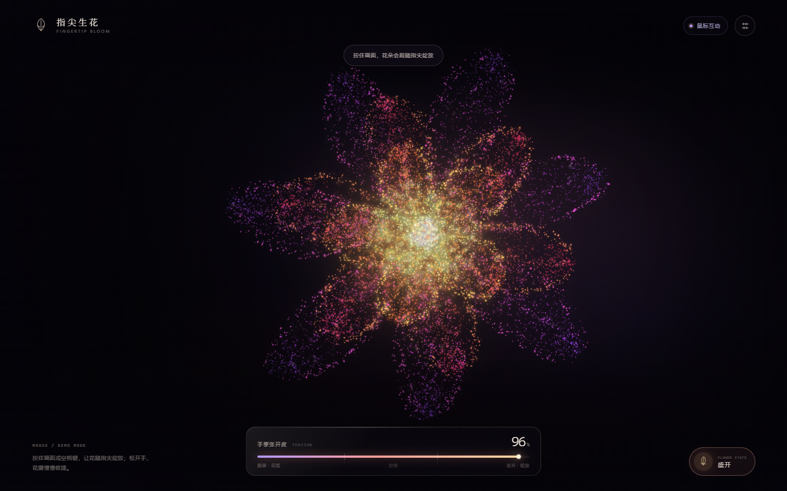
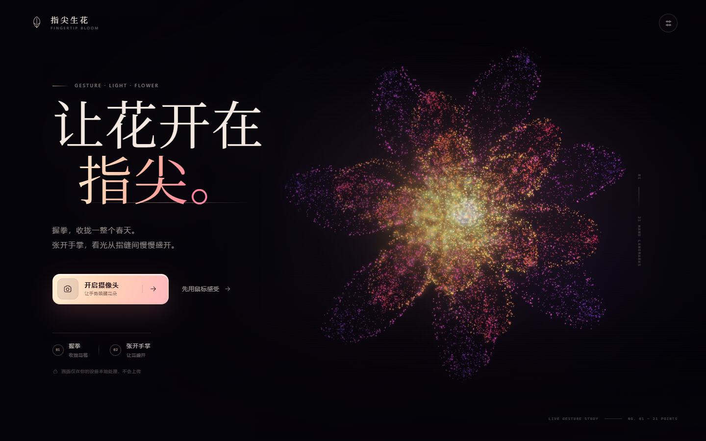
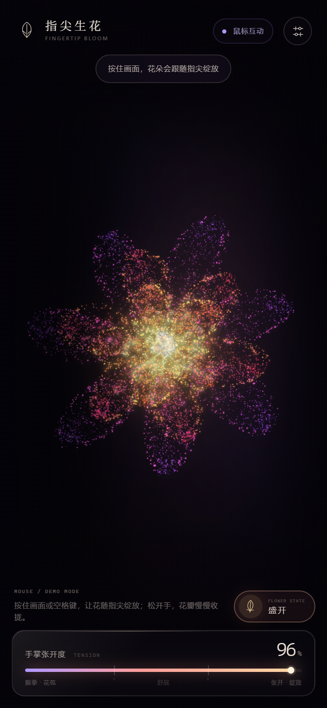
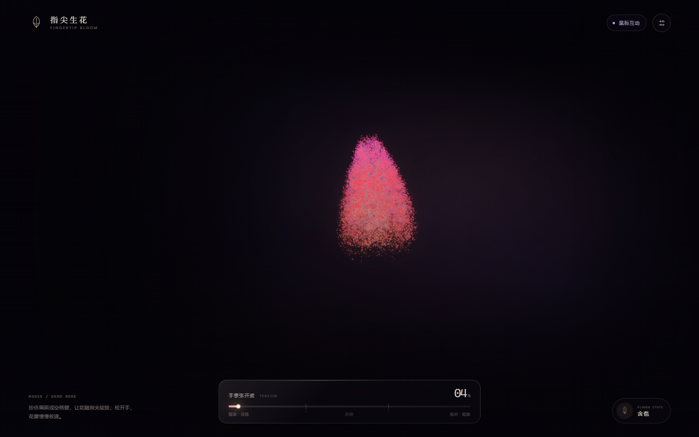
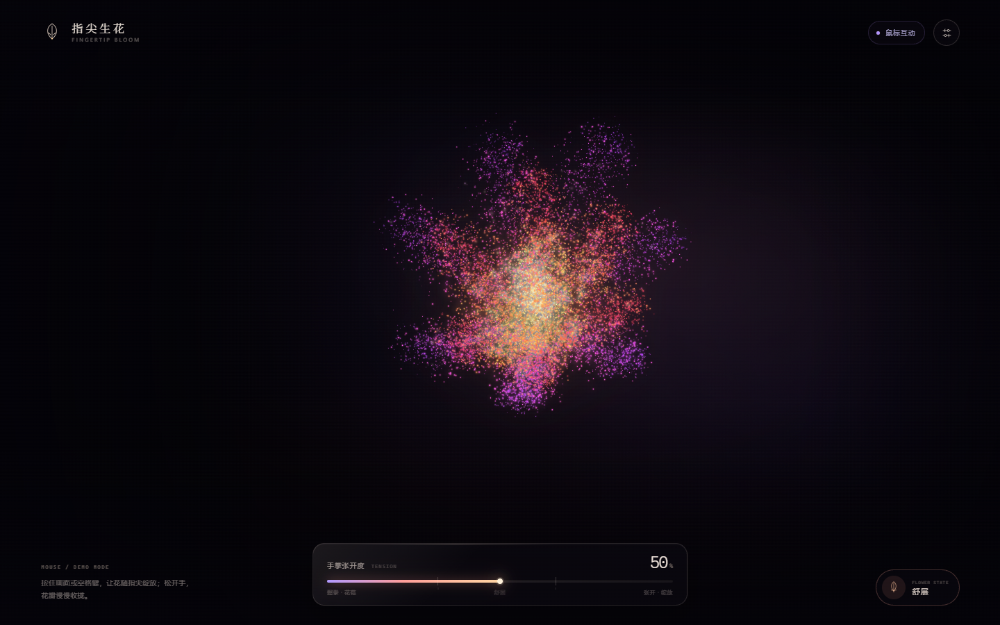

# 指尖生花 · Fingertip Bloom

用摄像头和手势驱动的一朵实时粒子花。握拳，花收拢为花苞；张开手掌，粒子便从花心向外盛开。花的中心会跟随掌心轻微移动，指尖经过花瓣时，粒子会像被轻轻触碰一样让开一点。

技术栈：**Three.js（自定义 ShaderMaterial） + MediaPipe Hands（21 关键点） + 原生 JavaScript / HTML / CSS**。本地运行无需构建、无需安装前端依赖，所有依赖已放在本地 `vendor/` 中；发布到 GitHub Pages 时，内置脚本会生成带 SEO 的静态产物。



| 首屏 | 移动端绽放 |
| --- | --- |
|  |  |

| 花苞状态 | 中间过渡 |
| --- | --- |
|  |  |

---

## 快速开始

### 方式一：内置无依赖静态服务器（推荐）

```bash
cd gesture-flower
node server.mjs
```

打开 <http://localhost:8080>，点击「开启摄像头」，在浏览器弹窗中允许权限。

需要 Node.js 18+。项目没有 npm 依赖，不需要 `npm install`。

端口被占用时：

```bash
# macOS / Linux
PORT=8081 node server.mjs

# Windows PowerShell
$env:PORT=8081; node server.mjs
```

### 方式二：任意静态 HTTP 服务器

```bash
python -m http.server 8080
# 或 npx serve .
```

然后打开 <http://localhost:8080>。

> **不要直接双击 `index.html`。** ES Module、`getUserMedia`、WebAssembly 都需要 `http://localhost` 或 HTTPS 环境；`file://` 下摄像头与模块都会失败。

### 在手机上使用

移动端布局已适配，但浏览器安全策略要求摄像头页面处于 **HTTPS 或本机 localhost**。直接用局域网 HTTP 地址在手机上打开时，界面正常，但摄像头会被浏览器阻止。

可选方案：

1. 用 HTTPS 隧道（例如 Cloudflare Tunnel / ngrok）把本地 8080 端口映射为 HTTPS；
2. 把项目部署到 GitHub Pages（见下一节，**推荐**）；
3. 在桌面浏览器中使用「响应式设计模式」查看移动布局。

---

## 部署到 GitHub Pages

项目已经内置 GitHub Actions 和静态构建脚本。GitHub Pages 免费方案需要仓库是 **Public**。

### 1. 推送到 GitHub

新建一个公开仓库，例如：

```text
https://github.com/<你的用户名>/fingertip-bloom
```

把整个 `gesture-flower` 目录推送上去：

```bash
git init -b main
git add .
git commit -m "feat: fingertip bloom"
git remote add origin https://github.com/<你的用户名>/fingertip-bloom.git
git push -u origin main
```

### 2. 开启 Actions 部署

进入仓库：

```text
Settings → Pages → Build and deployment → Source
```

选择 **GitHub Actions**。  
之后每次推送到 `main` / `master`，`.github/workflows/pages.yml` 会自动执行：

1. 运行 `tests/tension.test.mjs`
2. 执行 `scripts/build-pages.mjs`
3. 生成 `dist/` 静态站点
4. 上传并部署到 GitHub Pages

### 3. 访问线上地址

默认地址是：

```text
https://<你的用户名>.github.io/fingertip-bloom/
```

也可以去仓库的 **Actions** 页面查看每次部署的 URL。GitHub Pages 提供正式 HTTPS，手机浏览器可以直接使用摄像头。

> 如果仓库名是 `<你的用户名>.github.io`，站点的地址就是根域名 `https://<你的用户名>.github.io/`。

### 4. 自定义域名（可选）

如果你以后购买了域名，例如 `flower.example.com`：

1. 修改 `pages.config.json`：

```json
{
  "customDomain": "flower.example.com"
}
```

2. 在 DNS 添加一条 `CNAME`：

```text
flower.example.com → <你的用户名>.github.io
```

3. 在仓库 `Settings → Pages` 中填入同一个自定义域名，并启用 **Enforce HTTPS**
4. 重新推送；构建脚本会自动生成 `CNAME`，canonical、Open Graph 和 sitemap 也会切换为新域名

如果是根域名（例如 `example.com`），应使用 GitHub Pages 文档中的 `A` 记录配置。

### 5. 构建脚本会生成什么

`node scripts/build-pages.mjs` 会生成：

```text
dist/
├─ index.html          # 注入 canonical / OG / Twitter / JSON-LD
├─ robots.txt          # 允许抓取，指向 sitemap
├─ sitemap.xml
├─ 404.html            # 品牌化 404
├─ .nojekyll
├─ CNAME               # 仅在配置了 customDomain 时生成
├─ src/
├─ assets/             # 包含 1200×630 的 og-cover.jpg
├─ vendor/
└─ licenses/
```

不会把 `preview/`、`tests/`、`server.mjs` 或本地构建脚本放入线上产物，减少静态站点体积。

本地预览构建结果：

```powershell
# Windows PowerShell
$env:GITHUB_REPOSITORY = "你的用户名/fingertip-bloom"
node scripts/build-pages.mjs

# macOS / Linux
GITHUB_REPOSITORY=你的用户名/fingertip-bloom node scripts/build-pages.mjs
```

构建使用 `GITHUB_REPOSITORY` 自动推导 Pages 地址；在 GitHub Actions 中不需要额外配置。也可以显式设置 `SITE_URL=https://example.com/`。

### 6. 提交搜索引擎

上线后：

1. 在 [Google Search Console](https://search.google.com/search-console) 添加资源（推荐用 DNS 验证）
2. 在 [Bing Webmaster Tools](https://www.bing.com/webmasters) 添加站点
3. 提交 `https://你的域名/sitemap.xml`
4. 国内收录可以在百度搜索资源平台提交 sitemap

说明：搜索引擎收录需要时间，通常几天到几周；新域名无法保证立刻出现在搜索结果前列。

---

## 操作方式

| 场景 | 操作 | 结果 |
| --- | --- | --- |
| 摄像头模式 | 握拳 | `tension < 0.32`，粒子聚合为花苞 |
| 摄像头模式 | 手掌慢慢张开 | `0.32 – 0.66`，花苞柔和舒展 |
| 摄像头模式 | 完全张开手掌 | `tension > 0.66`，粒子向外盛开 |
| 摄像头模式 | 移动手掌 / 食指 | 花心轻微跟随，指尖局部推开粒子 |
| 鼠标模式 | 按住画面 / 空格键 | 花朵绽放；松开后收拢 |
| 通用 | `R` | 重置视角 |
| 通用 | `Esc` | 关闭调节面板 / 错误弹窗 |

右上角「调节」面板支持：

- 粒子数量 **5,000 – 20,000** 实时调节（桌面默认 15,000，移动端默认 9,000）
- 手部 21 关键点与连线显示 / 隐藏
- 摄像头半透明背景显示 / 隐藏
- 鼠标模式下一键切换到摄像头 / 摄像头模式下关闭摄像头
- 查看 FPS、回到初始视角、查看张力公式

可选 URL 参数：

- `?demo=1`：跳过首屏，直接进入鼠标体验
- `?particles=18000`：指定初始粒子数（自动限制在 5,000 – 20,000）

---

## 手势张力公式

MediaPipe Hands 输出 21 个归一化关键点。代码使用其中 4 根手指计算，忽略拇指，以免拇指姿态单独造成误判。

### 1. 尺度无关的伸展比

对每根手指 `f ∈ {index, middle, ring, pinky}`，记手腕为 `wrist`、指根（MCP）为 `mcp`、指尖为 `tip`：

```text
R_f = ‖tip_f − wrist‖ / ‖mcp_f − wrist‖
E   = mean(R_f)
```

用「手腕 → 指根」作尺子，可以抵消手掌离镜头远近造成的距离变化。

### 2. 归一化

```text
reachNorm = smoothstep(1.00, 1.90, E)
```

- `E ≈ 1.0`：手指收拢，接近握拳
- `E ≥ 1.9`：手指充分伸展
- 中间使用 smoothstep 平滑过渡

### 3. 指节伸直度修正

握拳时手指会折叠，而单纯距离比偶尔会被手掌朝向影响，因此再加入第二项：

```text
bend_f = angle(mcp_f→pip_f, pip_f→tip_f)
S_f    = 1 − smoothstep(0.35, 1.65, bend_f)
B      = mean(S_f)

raw = clamp(0.78 × reachNorm + 0.22 × B, 0, 1)
```

伸手时 `mcp→pip` 与 `pip→tip` 几乎同向，`bend ≈ 0`；握拳卷曲时夹角变大，`B` 迅速下降，压低张力值。

### 4. 时间平滑

检测结果约 30fps，渲染约 60fps。用时间常数为 `0.085s` 的指数平滑，避免单帧抖动直接传到花朵：

```text
α        = 1 − exp(−Δt / 0.085)
tension += (raw − tension) × α
```

### 5. tension → 绽放目标

严格对应需求的阈值：

```text
bloomTarget = smoothstep(0.32, 0.66, tension)
```

| tension | 状态 |
| --- | --- |
| `0 – 0.32` | 花苞闭合 |
| `0.32 – 0.66` | 平滑舒展 |
| `0.66 – 1.00` | 完全绽放 |

### 6. 粒子位置缓动

`currentSpread` 只在 CPU 更新一次，随后在顶点着色器中完成每颗粒子的位置插值：

```text
framesNow  = clamp(Δt × 60, 0.35, 2.5)
currentSpread += (bloomTarget − currentSpread) × (1 − (1 − 0.1)^framesNow)
```

在 60fps 下它等价于需求中的：

```js
currentSpread += (targetSpread - currentSpread) * 0.1;
```

高刷 / 掉帧时保持相同的时间手感。花苞方向的位置是 `aBud`，完全绽放的位置是 `position`，顶点着色器执行：

```glsl
vec3 pos = mix(aBud, position, smoothstep(0.0, 1.0, uSpread));
```

因此 CPU 每帧只更新少量 uniform，15,000 个粒子的形变完全在 GPU 上完成。

> 想调整灵敏度，改 `src/config.js` 里的 `ratioFist` / `ratioOpen`，或左右拖动 `TENSION` 相关常量；阈值在 `bloom.closedAt` 与 `bloom.openAt`。

---

## 粒子花朵的实现

### 花瓣的极坐标生成

花朵由三层花瓣组成，分别为 7 / 6 / 5 片，再叠加黄金角螺旋排列的花蕊。每颗粒子落在某片花瓣的局部极坐标中：

```text
r(t)     = base + L · t · variation(t)
φ(t, s)  = φ_petal + s · (π / N) · layerWidth · W(t) · 0.97
           + curve · sin(πt) + ruffle(t)

W(t) = sin(π · t^0.74)^0.66 · (1 − 0.12t)
```

- `t ∈ [0,1]`：从花瓣根部到尖端
- `s ∈ [-1,1]`：花瓣中轴两侧；23% 的采样紧贴 `|s| ≈ 1` 的轮廓
- `N`：该层花瓣数，决定角向切片宽度
- `layerWidth`：该层花瓣的相对角宽（0.74 / 0.82 / 0.93）
- `W(t)`：花瓣在中段变宽、到尖端收窄的包络
- `variation(t)` 与 `ruffle(t)` 为每片花瓣的确定性随机扰动

真实实现还加入了：

- 23% 的粒子贴着花瓣轮廓，强化边缘
- 9% 的粒子沿中轴生成，形成轻微花瓣脉络
- 每层不同的 z 深度、卷曲度、颜色渐变
- 花瓣之间小幅不规则抖动，避免过于机械

### 花苞的生成

开放位置的极角与半径会映射到一个竖直水滴形花苞：半径越大，越靠近花苞顶部；花瓣围绕中轴卷起，形成闭合的螺旋结构。每颗粒子都保存自己的 `aBud` 坐标，顶点着色器负责在「花苞」与「完全绽放」之间做平滑、带弧线的混合。

### 材质与光晕

- 花瓣主体：`NormalBlending` + 软圆点片元着色器，保留玫瑰 / 珊瑚 / 紫罗兰的色相
- 辉光层：取主粒子的子集，扩大点精灵并叠加 `AdditiveBlending`，让花朵在深色背景里发光
- 背后另有一层极淡的体积光晕平面
- 中心花蕊有意识地聚集了暖金色粒子，形成发光的芯

---

## 性能设计

- 粒子数量默认桌面 **15,000**、移动端 **9,000**，可在 5,000 – 20,000 调整
- 每颗粒子的位置形变在顶点着色器中直接插值，CPU 不逐个改写 buffer
- 摄像头识别节流到约 30fps，渲染独立以屏幕刷新率为上限
- 摄像头 overlay 使用独立 2D canvas，分辨率倍率上限 1.5；WebGL DPR 上限 2
- 非摄像头模式不启动 MediaPipe 模型，首屏加载更快
- 页面隐藏时暂停渲染循环，避免后台占用
- 支持 `prefers-reduced-motion`

---

## 目录结构

```text
gesture-flower/
├─ index.html
├─ styles.css
├─ server.mjs                 # 无依赖本地静态服务器（正确设置 wasm MIME）
├─ pages.config.json          # GitHub Pages 标题、描述、域名等配置
├─ scripts/
│  └─ build-pages.mjs         # 生成 dist/、SEO、robots、sitemap、404、CNAME
├─ .github/workflows/
│  └─ pages.yml               # GitHub Actions 自动部署 Pages
├─ .nojekyll
├─ src/
│  ├─ main.js                 # 应用状态、UI、摄像头 / 演示模式编排
│  ├─ config.js               # 粒子、阈值、平滑等可调参数
│  ├─ tension.js              # 21 点手势张力公式与平滑器
│  ├─ handTracker.js          # getUserMedia + MediaPipe Hands 封装
│  └─ flowerScene.js          # Three.js 粒子花、GLSL、花苞映射
├─ tests/
│  └─ tension.test.mjs        # 纯函数单元测试
├─ vendor/
│  ├─ three.module.js         # Three.js r169（本地化，MIT）
│  └─ mediapipe/hands/        # MediaPipe Hands 0.4.1675469240 + 模型资源
├─ assets/                    # favicon、opengraph 封面
├─ licenses/                  # 第三方许可证全文
├─ preview/                   # README 截图（不会打包进线上站点）
├─ THIRD_PARTY_NOTICES.md
└─ package.json
```

---

## 隐私

- 摄像头画面与 21 点识别全部在浏览器本地完成
- 没有任何上传、录制或分析请求
- 页面不加载远程字体、远程分析脚本或 CDN 资源
- 摄像头流在「关闭摄像头」或关闭页面后由浏览器释放

---

## 常见问题

### 摄像头权限被拒绝

点击地址栏左侧的摄像头图标，把权限改为「允许」，然后点击弹窗里的「重新尝试」。如果此前永久拒绝，需要进入浏览器的站点设置手动重置。

### 通过手机/局域网 IP 打开时没有摄像头

`http://192.168.x.x:8080` 不属于安全上下文。浏览器会在这种地址上禁用 `getUserMedia`。使用 HTTPS 隧道或 HTTPS 托管。

### 一直提示「寻找手部」

- 把手完整放进画面
- 保证光源从前方照亮手掌，避免逆光
- 不要离镜头过近
- 等首帧模型加载完成；首次打开需要下载/初始化本地模型资源

### 模型 404 或 wasm 加载失败

本地开发时使用 `node server.mjs`，它显式设置了：

```text
.wasm  → application/wasm
.data  → application/octet-stream
```

GitHub Pages 会自动设置 `.wasm` 的 MIME 类型。确认 `vendor/mediapipe/hands/` 下的 `.wasm`、`.data`、`.tflite` 等文件已经被推送到仓库，并且没有被 `.gitignore` 排除。

### 页面只有背景，没有粒子花

检查浏览器是否支持 WebGL2，并尝试开启硬件加速。应用在初始化失败时会显示错误弹窗，而不是静默黑屏。

### 摄像头打开了，但画面是空白的

确认浏览器地址是 `localhost`/HTTPS，且其他应用没有独占摄像头。浏览器视频在页面上以镜像方式绘制；手部画布会与 21 点对齐。

---

## 测试

```bash
node --test tests/tension.test.mjs
# 或
npm test
```

测试覆盖：

- 张开手 → 高张力、`open`
- 握拳 → 低于 0.32、`closed`
- 阈值与平滑映射
- 指数平滑收敛且不过冲
- 无效 / 不合理关键点过滤

本项目还用真实 MediaPipe Hands 模型和样例手部视频验证了摄像头权限、手部检测与「张开 → 绽放」链路，并在 1440×900、390×844、844×390 等视口检查了布局与交互。

---

## 第三方资源

- [Three.js](https://threejs.org/) r169 — MIT，许可证见 [`licenses/three-MIT.txt`](licenses/three-MIT.txt)
- [MediaPipe Hands](https://developers.google.com/mediapipe/solutions/vision/hand_landmarker) 0.4.1675469240 — Apache-2.0，许可证见 [`licenses/mediapipe-Apache-2.0.txt`](licenses/mediapipe-Apache-2.0.txt)
- 完整声明见 [`THIRD_PARTY_NOTICES.md`](THIRD_PARTY_NOTICES.md)

字体使用设备本地字体回退（宋体 / Songti / Iowan Old Style 等），不加载远程字体。
